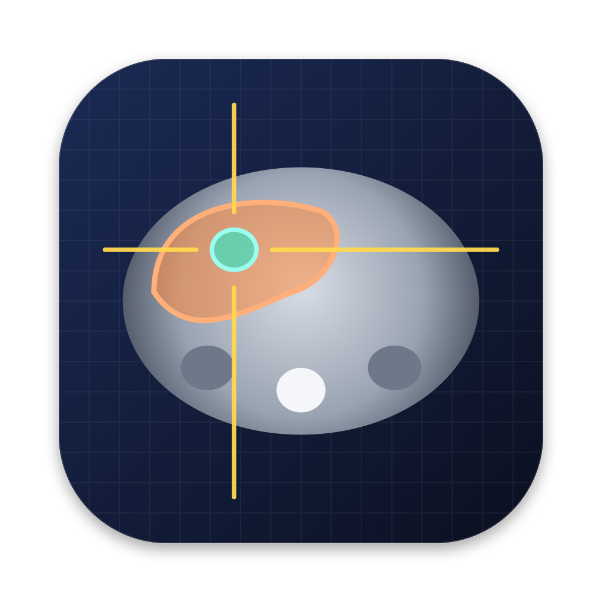
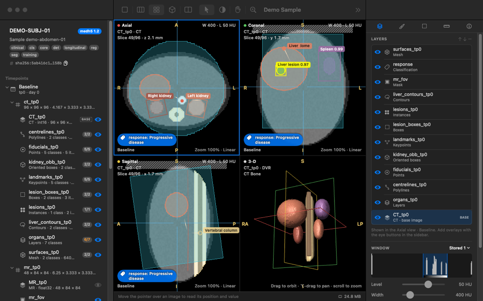

<p align="center"></p>

# medh5 Viewer

**A native macOS viewer and editor for [medh5](https://github.com/medh5-project/medh5)
files — one medical-imaging subject, at every timepoint, with all of its ground
truth.**

medh5 Viewer opens a `.medh5` sample and shows everything in it: every
timepoint and image, segmentations in all of their voxel encodings, boxes,
keypoints, contours, polylines and meshes, classifications, registrations
between visits, provenance, quality, integrity and — from format 1.1 — the
clinical history around the images. It edits them too: paint and refine
segmentations, draw geometric annotations, curate the sample's document and
label set, import and export NIfTI, and save through the medh5 engine's
copy-on-write amendment, validated on every save.

It is built with AppKit, SwiftUI and Metal, and reads and writes files through
the medh5 engine itself (Rust, `medh5` 2.2.4) — so it writes exactly the bytes
the Python package and the `medh5` command line write.



## Features

- **Multi-planar viewing on the GPU** — axial, coronal and sagittal views in
  true anatomical planes or along the acquisition axes, with a shared
  crosshair, window/level presets, 21 colormaps, thick-slab MIP, MinIP and
  average, and images on different grids or frames placed by their geometry
  and the stored transforms.
- **3-D** — volume ray casting (DVR with presets, MIP, MinIP, average,
  isosurfaces), segmentation surfaces and mesh annotations in one
  depth-correct scene, with a clipping box.
- **Every annotation kind** — `labelmap`, `layers`, `bitmask`, `instances`,
  `probmap` and `mask`; `boxes`, `obb`, `keypoints`, `points`, `contours`,
  `polylines` (format 1.2) and `mesh`; `classification`. Coverage — what an
  annotation *can express* versus what was *looked for* — is shown, and kept
  through every edit.
- **Longitudinal** — timepoints side by side, linked through the
  registration stored in the file; follow-up overlaid on baseline through an
  affine or a displacement field.
- **Segmentation editing** — brush and eraser in millimetres (2-D disc or
  3-D sphere, paint policies, intensity range), 2-D/3-D fill, threshold,
  region growing, morphology, hole filling, keeping the largest component,
  island removal, interpolation between slices and logical operations, each
  one undoable step.
- **Annotations and measurements** — draw boxes, points, polylines and
  contours; rulers, angles and ROI statistics, exported as CSV.
- **Curation** — the sample document and label set, edited and checked by
  the engine; validation at every level with medh5's diagnostic codes; digest
  and `content_id` verification; sampling indexes and recompression.
- **Clinical history** (format 1.1) — events on the subject's clock, when
  each happened and when it became known, and what was known at any cutoff.
- **Interoperability** — NIfTI import and export through the engine's
  converter; `.medh5c` collections.

## Install

Download the disk image from the [latest release](../../releases/latest),
open it and drag **medh5 Viewer** to Applications. Requires a Mac with Apple
silicon and macOS 14 or later. See [Installing](docs/INSTALL.md).

No data at hand? **Help ▸ Open Demo Sample** writes a synthetic two-visit
sample with every kind of annotation and opens it.

## Documentation

- [User guide](docs/USER_GUIDE.md) — also in the app, under Help
- [Installing](docs/INSTALL.md) · [Building from source](docs/BUILDING.md)
- [Architecture](docs/ARCHITECTURE.md) · [App design](docs/APP_DESIGN.md) ·
  [The engine bridge](docs/BRIDGE.md)
- [medh5 documentation](https://medh5.readthedocs.io/) — the format, its
  specification and the Python package

## Build

```bash
scripts/build-bridge.sh    # the medh5 engine (Rust) as a static library
scripts/build-app.sh       # → medh5 Viewer.app
scripts/test.sh            # every test suite
scripts/package-dmg.sh     # → the disk image, a zip and their checksums
```

Products go to `build/` (or, when the repository is in iCloud Drive, to a
folder in `~/Library/Caches`; the scripts print where). Requires Xcode 26+,
Rust and CMake. Details in [BUILDING.md](docs/BUILDING.md).

## License

[MIT](LICENSE). The app links the medh5 engine (MIT) and, through it, HDF5,
C-Blosc2, LZ4, Zstandard and zlib, which carry their own licenses: see
[THIRD_PARTY_NOTICES](THIRD_PARTY_NOTICES), also under Help ▸
Acknowledgements in the app.
