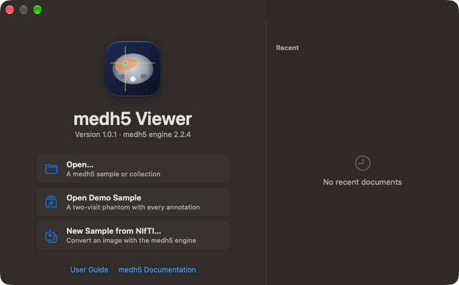
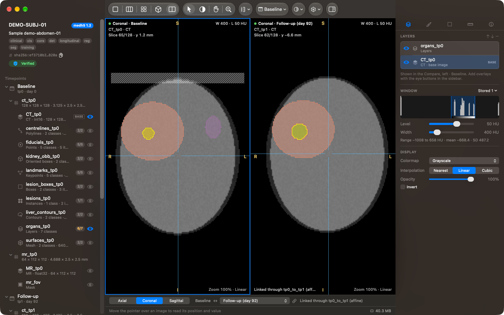
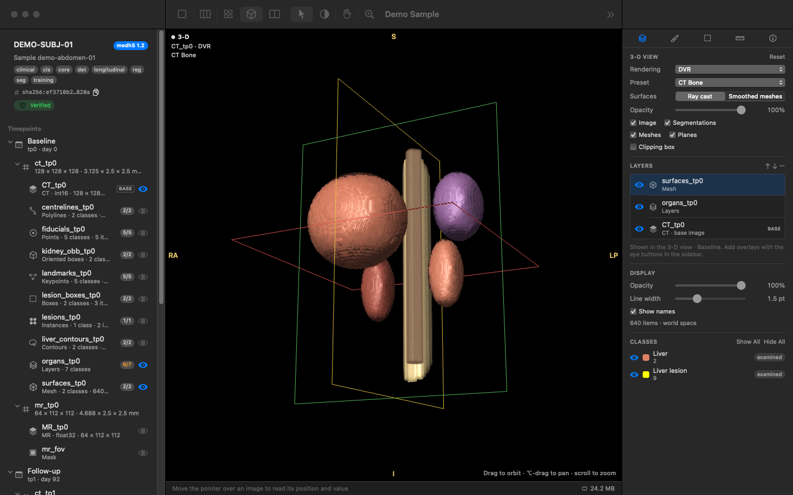

# medh5 Viewer — User Guide

medh5 Viewer opens, inspects and edits [medh5](https://github.com/medh5-project/medh5)
samples on the Mac: the images of a subject, every kind of annotation the
format holds, the transforms between frames, the clinical history, and the
curation records. It reads and writes files through the medh5 engine itself
(version 2.2.3), so what it shows and what it saves is exactly what the
format defines.

- [Getting started](#getting-started)
- [The document window](#the-document-window)
- [The sidebar](#the-sidebar)
- [Viewing images](#viewing-images)
- [Layers](#layers)
- [Comparing timepoints](#comparing-timepoints)
- [The 3-D view](#the-3-d-view)
- [Editing segmentations](#editing-segmentations)
- [Geometric annotations](#geometric-annotations)
- [Measurements](#measurements)
- [The sample's records](#the-samples-records)
- [Checking a file](#checking-a-file)
- [Importing and exporting](#importing-and-exporting)
- [Saving](#saving)
- [Settings](#settings)
- [Keyboard shortcuts](#keyboard-shortcuts)
- [Troubleshooting](#troubleshooting)

## Getting started

medh5 Viewer needs macOS 14 Sonoma or later on a Mac with Apple silicon.
To install it, open the disk image and drag **medh5 Viewer** to
Applications ([details](INSTALL.md)).

When no document is open, the welcome window offers:

- **Open…** — a sample (`.medh5`) or a collection (`.medh5c`). You can also
  drop files on the app's icon or double-click them in the Finder.
- **Open Demo Sample** — a synthetic two-visit abdominal phantom that holds
  every kind of annotation: segmentations, boxes, oriented boxes, points,
  keypoints, contours, polylines, a mesh, a classification, an MR field of
  view in another frame and the transforms between the visits. It is the
  quickest way to explore the app; it opens as an untitled document.
- **New Sample from NIfTI…** — converts NIfTI images (and masks) into a new
  sample with the engine's converter.
- **Open Recent**, and links to this guide and the medh5 documentation.

## The document window

The window has three parts:

- the **sidebar** on the left lists what the sample holds;
- the **viewer** in the middle shows one to four views;
- the **inspector** on the right has five tabs: **Layers**, **Segment
  editor**, **Annotations**, **Measurements** and **Info**.

The toolbar holds the layout buttons, the tools, the timepoint menu, the
window presets of the base image, the 3-D menu and the inspector button.
The status bar under the views reads out what is under the pointer: the
world position (in the sample's coordinate system), the voxel index, the
stored and physical value with units, and the classes of every visible
segmentation there. On its right it shows how much memory the window's
volumes use.

A file the app cannot change opens **read-only**, with a banner saying why:

- the file declares a later format version (for example 1.3) than the
  engine knows; the app shows the *projection* the engine makes of it;
- one of its stored digests does not match its bytes (repair it with
  `medh5 fix`);
- it is a member of a collection.

## The sidebar

The header names the subject and the sample, the format version, the
profiles the sample declares (such as `clinical`, `seg`, `longitudinal`),
its `content_id` (click the copy button to copy it) and the result of the
integrity check that runs when the file opens: **Verified**, **Integrity
failed**, or a note when the file is a projection.

Below it:

- **Timepoints** — each visit with its grids; under each grid, its images
  and the annotations drawn on it. Annotations that span visits appear
  under their own heading. A badge such as **6/7** gives the annotation's
  coverage: how many of the classes it can express were actually examined.
  It is orange when some were not.
- **Transforms** — the stored transforms with their kind and the frames they
  connect.
- **Label set** — the sample's classes with their colours.
- **Curation** — provenance, quality, de-identification, the clinical
  history and the sampling index.

Click the **eye** button of an image or annotation to show or hide it in
the active view. Double-click an image to make it the **base image**: the
one the views are framed on and whose window/level the presets change.
Select a row to see everything about it in the **Info** tab. Right-click a
row for its actions.

## Viewing images

### Layouts

| Layout | Key | Shows |
|---|---|---|
| Single view | 1 | one plane (⌥⌘A, ⌥⌘C, ⌥⌘S pick axial, coronal or sagittal) |
| 1 × 3 | 2 | axial, coronal and sagittal side by side |
| 2 × 2 | 3 | the three planes and the 3-D view |
| 3-D only | 4 | the 3-D view |
| Compare timepoints | 5 | the same plane at two visits, linked |

The active view has a blue frame; click a view to make it active. The
inspector's Layers tab shows the layers of the active view.

### Planes and orientation

**Anatomical planes** (the default) reformat the images into true axial,
coronal and sagittal planes of the patient. **Aligned planes** follow the
base image's own axes instead, which avoids resampling an oblique
acquisition. Choose in the View menu, or set the default in Settings.

Views follow the **radiological** convention by default: the patient's
left is on the screen's right. Settings switches to the **neurological**
convention. The letters on the edges of each view (A, P, R, L, S, I) name
the anatomical direction at that edge; on an oblique plane they combine
(for example `LA`).

A 2-D image (a radiograph) shows in a single view of its own plane.

### Moving around

| Do | With |
|---|---|
| set the crosshair (all views follow) | click, with the Navigate tool (V) |
| next / previous slice | scroll, or ↑ / ↓ |
| ten slices | Page Up / Page Down |
| first / last slice | Home / End |
| pan | ⌥-drag, middle-drag, or the Pan tool (H) |
| zoom | ⌃-drag, right-drag, pinch, ⌘-scroll, or the Zoom tool (Z) |
| window / level | ⇧-drag, or the Window/Level tool (W): horizontal for width, vertical for level |
| reset the view | ⌘0 |

The corners of each view show the plane, the base image and its modality,
the slice number and position, the window, the timepoint, the zoom and the
interpolation. View ▸ Show Crosshair, Show Overlays and Show Orientation
Labels turn those off.

### Window and level

The Layers tab of the base image shows its histogram with the current
window, sliders for level and width, and the window presets stored in the
file (for CT also the usual ones: soft tissue, lung, bone, brain…). **Auto**
sets the window from the 1st and 99th percentiles; images without stored
presets start with it. The toolbar's preset menu and Image ▸ Window Presets
offer the same presets; Image ▸ Auto Window is ⌥⌘W.

### Time series and channels

For an image with a time axis, a slider under the view picks the frame;
for a multi-channel image, a menu picks the channel (⌥⌘] and ⌥⌘[ step
through channels). RGB images show in colour. ⌘] and ⌘[ step through the
timepoints of the sample.

## Layers

Each view draws a stack of layers: the base image at the bottom, then the
images and annotations you turn on with their eye buttons. In the Layers
tab you can reorder layers, hide them, and change their opacity.

**Images** can be fused over the base image with a colormap (21 maps,
from grayscale and hot to perceptually uniform ones), interpolation
(nearest, linear or cubic), opacity, inversion and a lower threshold that
hides small values. An image on another grid of the same frame is placed by
its geometry. An image in **another frame** is placed through the transform
that connects the frames — a matrix, or a displacement field — and the
Layers tab names the transform used. When no transform connects the frames,
the image is not drawn and the view says why: medh5 never assumes that two
frames are aligned.

**Segmentations** (label maps, multi-layer label maps, bitmasks, masks and
instance maps) draw filled, outlined, or both, with a fill opacity and an
outline width. Each class can be shown or hidden, and the list says whether
the class was **examined** or whether the annotation **can express only**
it — its absence then means nothing, because nobody looked for it. Regions
marked *ignore* draw hatched (turn this off with **Show the ignore
region**). Instance maps colour each instance, or each class.

**Probability maps** draw each class as a ramp in its class colour, with a
contour at the stored threshold.

**Geometric annotations** — boxes, oriented boxes, points, keypoints,
contours, polylines and meshes — draw where they cut the slice, with their
class names. A **classification** shows as a badge in the corner of each
view.

## Comparing timepoints

The Compare layout (5) shows the same plane at two visits. Pick the plane
and the second visit in the bar under the views. When the sample stores a
transform between the visits' frames, the views are **linked through it**:
the crosshair and the slice in one view follow the other through the
transform. Without one, the views are linked by voxel index, and the bar
says **not registered**.

## The 3-D view

The 3-D view renders the base image as a volume, the segmentations as
surfaces, the meshes, and the three slice planes.

| Do | With |
|---|---|
| rotate | drag |
| pan | ⌥-drag |
| zoom | scroll or pinch |

In the Layers tab (with the 3-D view active):

- **Rendering**: direct volume rendering (**DVR**) with a preset (CT bone,
  soft tissue, lung, angiography or skin, or MR); maximum (**MIP**),
  minimum (**MinIP**) and
  **average** intensity projections; or an **isosurface**.
- **Surfaces**: segmentations as **ray-cast** label surfaces or as
  **smoothed meshes**.
- What to show: image, segmentations, meshes, planes; a **clipping box**
  to cut into the volume; **Reset** returns to the default view.

<!-- B1: Editing segmentations, Geometric annotations, Measurements -->
<!-- B2: The sample's records, Checking a file, Importing and exporting -->

## Saving

**Save** (⌘S) writes your changes into the file. The app never rewrites a
file in place: it amends the sample copy-on-write through the engine —
everything you did not change is copied unchanged with its digests, what
you changed is written again and digested, and the engine validates the
result before it replaces the original. **Save As…** (⇧⌘S) writes the
amended sample to a new file and leaves the original alone. **Revert to
Saved** discards your changes.

Saving runs in the background; you can keep working while it does. The app
does not autosave: amending a large file continuously is neither cheap nor
what a curator expects.

## Settings

- **General**: the default layout, anatomical or aligned planes, the
  radiological or neurological convention, and the size of the demo sample.
- **Rendering**: the default interpolation, the 3-D quality (draft,
  standard, high) and the memory budget. Beyond the budget, volumes no view
  shows are released, least recently used first, and read again when
  needed.
- **Performance**: how many threads one engine call uses to decompress and
  hash (the default is the number of performance cores).

## Keyboard shortcuts

Help ▸ Keyboard Shortcuts lists them all. The most used:

| Key | Does |
|---|---|
| 1 – 5 | layouts: single, 1 × 3, 2 × 2, 3-D only, compare |
| V, W, H, Z | Navigate, Window/Level, Pan, Zoom tools |
| ⌘0 | reset the view |
| ⌘= / ⌘- | zoom in / out |
| ⌥⌘A / ⌥⌘C / ⌥⌘S | single view: axial / coronal / sagittal |
| ⌥⌘X | show or hide the crosshair |
| ⌥⌘O | show or hide overlays |
| ⌥⌘W | auto window |
| ⇧⌘I | invert the base image |
| ⌘] / ⌘[ | next / previous timepoint |
| ⌥⌘] / ⌥⌘[ | next / previous channel |
| ⌥⌘L | segmentations as outlines only |
| ⌥⇧⌘H | hide all segmentations |
| ⌃⌘S | show or hide the sidebar |
| ⌥⌘I | show or hide the inspector |
| ⇧⌘E | export a screenshot |
| ⇧⌘N | new sample from NIfTI |

## Troubleshooting

**"medh5 Viewer can't be opened because Apple cannot check it for
malicious software."** Release builds without a Developer ID signature are
signed ad hoc. Control-click the app in Applications, choose **Open**, and
confirm once ([details](INSTALL.md)).

**The file opens read-only.** The banner says why: a later format version
(the app shows the engine's projection), a failed integrity check (repair
the file with `medh5 fix`), or a collection member (open the sample file
itself to edit it).

**An image is missing from a view.** It may be in another frame with no
transform to the view's frame; the view names the layers it could not
place.

**Memory.** Volumes are read when a view needs them and released, least
recently used first, beyond the budget set in Settings ▸ Rendering.
Segmentations you are editing stay in memory until you save.
