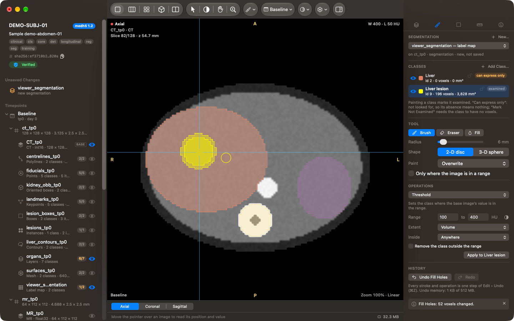
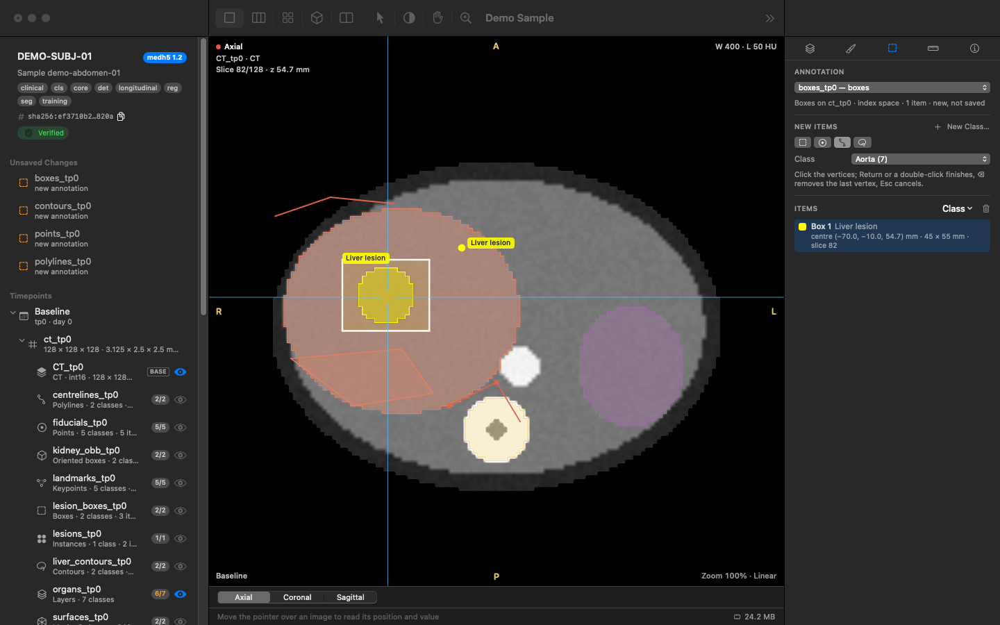
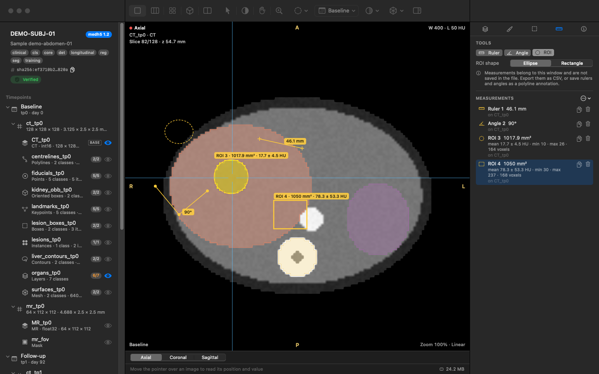
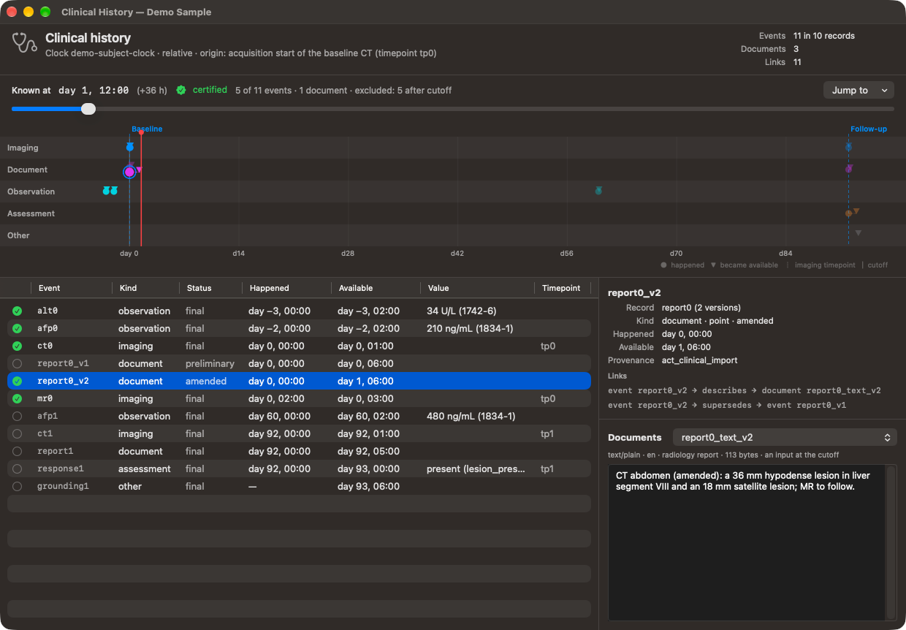

# medh5 Viewer — User Guide

medh5 Viewer opens, inspects and edits [medh5](https://github.com/medh5-project/medh5)
samples on the Mac: the images of a subject, every kind of annotation the
format holds, the transforms between frames, the clinical history, and the
curation records. It reads and writes files through the medh5 engine itself
(version 2.2.4), so what it shows and what it saves is exactly what the
format defines.

- [Getting started](#getting-started)
- [The document window](#the-document-window)
- [The sidebar](#the-sidebar)
- [Viewing images](#viewing-images)
- [Layers](#layers)
- [Comparing timepoints](#comparing-timepoints)
- [The 3-D view](#the-3-d-view)
- [Editing segmentations](#editing-segmentations)
- [Geometric annotations](#geometric-annotations)
- [Measurements](#measurements)
- [The sample's records](#the-samples-records)
- [Checking a file](#checking-a-file)
- [Importing and exporting](#importing-and-exporting)
- [Saving](#saving)
- [Settings](#settings)
- [Keyboard shortcuts](#keyboard-shortcuts)
- [Troubleshooting](#troubleshooting)

## Getting started

medh5 Viewer needs macOS 14 Sonoma or later on a Mac with Apple silicon.
To install it, open the disk image and drag **medh5 Viewer** to
Applications ([details](INSTALL.md)).

When no document is open, the welcome window offers:

- **Open…** — a sample (`.medh5`) or a collection (`.medh5c`). You can also
  drop files on the app's icon or double-click them in the Finder.
- **Open Demo Sample** — a synthetic two-visit abdominal phantom that holds
  every kind of annotation: segmentations, boxes, oriented boxes, points,
  keypoints, contours, polylines, a mesh, a classification, an MR field of
  view in another frame and the transforms between the visits. It is the
  quickest way to explore the app; it opens as an untitled document.
- **New Sample from NIfTI…** — converts NIfTI images (and masks) into a new
  sample with the engine's converter.
- **Open Recent**, and links to this guide and the medh5 documentation.

## The document window

The window has three parts:

- the **sidebar** on the left lists what the sample holds;
- the **viewer** in the middle shows one to four views;
- the **inspector** on the right has five tabs: **Layers**, **Segment
  editor**, **Annotations**, **Measurements** and **Info**.

The toolbar holds the layout buttons, the viewing tools, a menu of the
measuring, segmentation and annotation tools (its icon is the one in use),
the timepoint menu, the window presets of the base image, the 3-D menu and
the inspector button.
The status bar under the views reads out what is under the pointer: the
world position (in the sample's coordinate system), the voxel index, the
stored and physical value with units, and the classes of every visible
segmentation there. On its right it shows how much memory the window's
volumes use.

A file the app cannot change opens **read-only**, with a banner saying why:

- the file declares a later format version (for example 1.3) than the
  engine knows; the app shows the *projection* the engine makes of it;
- one of its stored digests does not match its bytes (repair it with
  `medh5 fix`);
- it is a member of a collection.

## The sidebar

The header names the subject and the sample, the format version, the
profiles the sample declares (such as `clinical`, `seg`, `longitudinal`),
its `content_id` (click the copy button to copy it) and the result of the
integrity check that runs when the file opens: **Verified**, **Integrity
failed**, or a note when the file is a projection.

Below it:

- **Timepoints** — each visit with its grids; under each grid, its images
  and the annotations drawn on it. Annotations that span visits appear
  under their own heading. A badge such as **6/7** gives the annotation's
  coverage: how many of the classes it can express were actually examined.
  It is orange when some were not.
- **Transforms** — the stored transforms with their kind and the frames they
  connect.
- **Label set** — the sample's classes with their colours.
- **Curation** — provenance, quality, de-identification, the clinical
  history and the sampling index.

Click the **eye** button of an image or annotation to show or hide it in
the active view. Double-click an image to make it the **base image**: the
one the views are framed on and whose window/level the presets change.
Select a row to see everything about it in the **Info** tab. Right-click a
row for its actions: export as NIfTI, remove, or open the editor of a
curation record. Double-clicking a curation row opens its editor too.

While the sample has unsaved changes, an **Unsaved Changes** section at the
top lists them: imported images and segmentations, removed objects (struck
through in the tree), edits to the document and the label set.

## Viewing images

### Layouts

| Layout | Key | Shows |
|---|---|---|
| Single view | 1 | one plane (⌥⌘A, ⌥⌘C, ⌥⌘S pick axial, coronal or sagittal) |
| 1 × 3 | 2 | axial, coronal and sagittal side by side |
| 2 × 2 | 3 | the three planes and the 3-D view |
| 3-D only | 4 | the 3-D view |
| Compare timepoints | 5 | the same plane at two visits, linked |

The active view has a blue frame; click a view to make it active. The
inspector's Layers tab shows the layers of the active view.

### Planes and orientation

**Anatomical planes** (the default) reformat the images into true axial,
coronal and sagittal planes of the patient. **Aligned planes** follow the
base image's own axes instead, which avoids resampling an oblique
acquisition. Choose in the View menu, or set the default in Settings.

Views follow the **radiological** convention by default: the patient's
left is on the screen's right. Settings switches to the **neurological**
convention. The letters on the edges of each view (A, P, R, L, S, I) name
the anatomical direction at that edge; on an oblique plane they combine
(for example `LA`).

A 2-D image (a radiograph, a photograph) shows in a single view of its own
plane, marked **2-D**, with no anatomical letters: its plane is not a
slice of the patient.

### Thick slab

**View ▸ Thick Slab** projects the images of the slice views over a slab
centred on the plane: **maximum** (MIP), **minimum** (MinIP) or
**average** intensity, 5 to 40 mm thick. The corner of each view names the
projection while it is on. Segmentations still draw at the plane itself;
geometric annotations within the slab are shown.

### Moving around

| Do | With |
|---|---|
| set the crosshair (all views follow) | click, with the Navigate tool (V) |
| next / previous slice | scroll, or ↑ / ↓ |
| ten slices | Page Up / Page Down |
| first / last slice | Home / End |
| pan | ⌥-drag, middle-drag, or the Pan tool (H) |
| zoom | ⌃-drag, right-drag, pinch, ⌘-scroll, or the Zoom tool (Z) |
| window / level | ⇧-drag, or the Window/Level tool (W): horizontal for width, vertical for level |
| reset the view | ⌘0 |

The corners of each view show the plane, the base image and its modality,
the slice number and position, the window, the timepoint, the zoom and the
interpolation. View ▸ Show Crosshair, Show Overlays and Show Orientation
Labels turn those off.

### Window and level

The Layers tab of the base image shows its histogram with the current
window, sliders for level and width, and the window presets stored in the
file (for CT also the usual ones: soft tissue, lung, bone, brain…). **Auto**
sets the window from the 1st and 99th percentiles; images without stored
presets start with it. The toolbar's preset menu and Image ▸ Window Presets
offer the same presets; Image ▸ Auto Window is ⌥⌘W.

### Time series and channels

For an image with a time axis, a slider under the view picks the frame;
for a multi-channel image, a menu picks the channel (⌥⌘] and ⌥⌘[ step
through channels). RGB images show in colour. ⌘] and ⌘[ step through the
timepoints of the sample.

## Layers

Each view draws a stack of layers: the base image at the bottom, then the
images and annotations you turn on with their eye buttons. In the Layers
tab you can reorder layers, hide them, and change their opacity.

**Images** can be fused over the base image with a colormap (21 maps,
from grayscale and hot to perceptually uniform ones), interpolation
(nearest, linear or cubic), opacity, inversion and a lower threshold that
hides small values. An image on another grid of the same frame is placed by
its geometry. An image in **another frame** is placed through the transform
that connects the frames — a matrix, or a displacement field — and the
Layers tab names the transform used. When no transform connects the frames,
the image is not drawn and the view says why: medh5 never assumes that two
frames are aligned.

**Segmentations** (label maps, multi-layer label maps, bitmasks, masks and
instance maps) draw filled, outlined, or both, with a fill opacity and an
outline width. Each class can be shown or hidden, and the list says whether
the class was **examined** or whether the annotation **can express only**
it — its absence then means nothing, because nobody looked for it. Regions
marked *ignore* draw hatched (turn this off with **Show the ignore
region**). Instance maps colour each instance, or each class.

**Probability maps** draw each class as a ramp in its class colour, with a
contour at the stored threshold.

**Geometric annotations** — boxes, oriented boxes, points, keypoints,
contours, polylines and meshes — draw where they cut the slice, with their
class names. A **classification** shows as a badge in the corner of each
view.

## Comparing timepoints

The Compare layout (5) shows the same plane at two visits. Pick the plane
and the second visit in the bar under the views. When the sample stores a
transform between the visits' frames, the views are **linked through it**:
the crosshair and the slice in one view follow the other through the
transform. Without one, the views are linked by voxel index, and the bar
says **not registered**.

## The 3-D view

The 3-D view renders the base image as a volume, the segmentations as
surfaces, the meshes, and the three slice planes.

| Do | With |
|---|---|
| rotate | drag |
| pan | ⌥-drag |
| zoom | scroll or pinch |

In the Layers tab (with the 3-D view active):

- **Rendering**: direct volume rendering (**DVR**) with a preset (CT bone,
  soft tissue, lung, angiography or skin, or MR); maximum (**MIP**),
  minimum (**MinIP**) and
  **average** intensity projections; or an **isosurface**.
- **Surfaces**: segmentations as **ray-cast** label surfaces or as
  **smoothed meshes**.
- What to show: image, segmentations, meshes, planes; a **clipping box**
  to cut into the volume; **Reset** returns to the default view.

## Editing segmentations

The **Segment editor** tab of the inspector paints label maps. Pick the
segmentation to edit, or **New…** to create one on a grid of the sample
(choose the classes it can express; none of them counts as examined until
you paint it). A new segmentation is held in memory and written by the
next save.

### Classes and coverage

The **Classes** list shows each class with its colour, voxel count and
volume, and whether it was **examined** or the segmentation **can express
only** it. Painting a class marks it examined. Right-click a class to
paint with it, or to **Mark Examined** or **Mark Not Examined** (only for
a class with no voxels: absence means nothing for a class nobody looked
for). The lock keeps every tool off a class's voxels; the eye hides it.
**Add Class…** adds a class from the label set, or a new class with its
colour and an optional ontology code — it joins the label set too.

### Painting

| Tool | Key | Does |
|---|---|---|
| Brush | B | paints the active class |
| Eraser | E | erases the active class (or every unlocked class) |
| Fill | F | fills the connected region under the click, in the slice or the volume |

The brush's **radius** is in millimetres: [ and ] change it while you
paint. Its **shape** is a 2-D disc on the slice or a 3-D sphere. The
**paint policy** decides what the brush may cover: **Overwrite** anything,
**Only empty** voxels, or **Only inside** another class. **Only where the
image is in a range** limits the brush to voxels whose value lies in a
range (for example 100–400 HU), so a stroke follows a structure's edge.

Fill takes the connected voxels that hold what the clicked voxel holds,
or whose value is within a tolerance of it, or in a range.

### Operations

The **Operations** section applies one operation to the active class:

- **Threshold** — the class where the base image's value is in a range,
  in the volume or the current slice;
- **Region Growing** — from the crosshair over connected voxels close to
  its value (or in a range), in the slice or the volume;
- **Morphology** — dilate, erode, open or close, in 3-D or slice by slice;
- **Fill Holes** — fills the cavities of the class;
- **Keep Largest Component**, and **Remove Islands** smaller than a volume;
- **Interpolate Between Slices** — fills the slices between those holding
  the class, morphing its shape;
- **Logical Operations** — copy, move, subtract, intersect, swap or clear,
  between the active class and another.

### Undo

Every stroke and every operation is one step of **Edit ▸ Undo** (⌘Z),
which restores the voxels and the rest of the document's changes together.
The steps of a window's segmentation edits share a memory budget (Settings
▸ Editing); beyond it the oldest steps can no longer be undone, the newest
always can. Saving clears the undo history.

## Geometric annotations

The **Annotations** tab draws on the active slice view:

| Tool | Key | Draws |
|---|---|---|
| Box | ⇧B | drag a box; boxes lie on voxel edges of the base image's grid |
| Point | ⇧P | click a point (in a keypoint annotation, the next keypoint of the last object) |
| Polyline | ⇧L | click the vertices; Return or a double-click finishes, ⌫ removes the last vertex, Esc cancels |
| Contour | ⇧C | click the vertices of a closed outline; click the first vertex, or press Return, to close it |

New items go into the annotation chosen at the top — by default the
topmost one of that kind shown, or a new one when there is none — with the
class chosen under **New Items**. The **Items** list shows each item with
its class and position: click one to jump to it, change the class of the
selection, or delete it (⌫ in the view works too). Edit ▸ Cut, Copy, Paste
and Select All work on items. An annotation the clinical history attests
cannot be changed.

## Measurements

| Tool | Key | Measures |
|---|---|---|
| Ruler | M | a distance in millimetres |
| Angle | A | an angle in degrees: click the end of one arm, the vertex, then the end of the other |
| ROI | O | an ellipse or a rectangle: area, and the mean, SD, minimum and maximum of the image inside |

The **Measurements** tab lists them; copy them, delete them, or export
them with **Export CSV…** (also File ▸ Export ▸ Measurements). Measurements
belong to the window and are not saved in the file. To keep rulers and
angles, **Save as Polyline Annotation** turns them into a polyline
annotation of the sample.

## The sample's records

Three windows of the Window menu edit what the sample records about
itself. They belong to the document: they close with it, and what you
apply in them joins the document's unsaved changes, so Edit ▸ Undo takes it
back and Save writes it.

### The document

**Window ▸ Document** (⌥⌘D) edits the sample's document: the forms
**Identity** (sample and subject ids, sex, laterality, body part),
**Cohort**, **Timepoints** (add a timepoint, rename one you added, remove
one nothing uses), **Quality** and **De-identification**; the **Outline**,
the whole document as a tree; and **JSON**, the document as text.

Your changes are a draft until you click **Apply**. The engine then checks
the draft as it would store it: it writes it into a temporary copy of the
saved file and validates the copy. If the engine refuses the draft, the
window shows its message and nothing changes; **Revert** throws the draft
away. On a large file Apply takes about as long as a save.

### The label set

**Window ▸ Label Set** lists the sample's classes: id, key, name,
category, side, parents, and how many annotations use each. Select a class
to edit its key, name, colour, category, laterality, parents and codes
(bindings to vocabularies such as SNOMED CT, RadLex, FMA or UBERON). **+**
adds a class and **−** removes one.

A class that is in use — by a stored or unsaved annotation, a segmentation
you are editing, a child class, a skeleton or a relation — cannot be
removed, and its id cannot change. **Apply** has the engine check the set
(for example, parents that form a cycle are refused).

### The clinical history

**Window ▸ Clinical History** shows the clinical records of a sample with
the `clinical` profile, on the subject's clock:

- a **timeline** with a row for each kind of event (imaging, document,
  observation, assessment, other), marking when each event happened (with
  its uncertainty) and when it became available, the imaging timepoints,
  and the cutoff;
- the **events** in a table, the selected event's details and links;
- the selected event's **documents**, with the spans annotations are
  grounded in highlighted.

The **Known at** slider sets a cutoff, and **Jump to** puts it at a scan.
The window then shows what the engine's strict prospective selection gives
at that moment: the events and documents a model may see are checked, the
rest are greyed out with the reason (after the cutoff, or superseded by a
later version). The badge beside it is **certified** when the engine can
vouch for the selection, and **uncertifiable** when a later revision's
availability is unknown or straddles the cutoff, so whether an earlier
version was still current cannot be known. This window does not edit the
records.

## Checking a file

**Tools ▸ Validate…** (⇧⌘V) runs the medh5 validator on the saved file at
the level you pick — **Structural**, **Semantic**, **Integrity** (the
default) or **Strict** — exactly as `medh5 validate` does. Findings are
grouped by severity, errors first, each with its code (such as `E304` or
`W914`), where in the file it is, and what is wrong; a warning the level
promotes to an error is marked so. Filter by code, path or message, or show
only errors or warnings. **Copy** (⌘C) copies the selected findings and
**Export JSON…** saves the whole report. **Validate Again** runs it again,
for example after you save. With unsaved changes, the window reminds you
that it checked the saved file; for a member of a collection it validates
the whole collection.

**Tools ▸ Verify Integrity** recomputes the digest of every object and the
sample's `content_id`, and lists each object with its stored digest and
whether it matches. Problems are listed at the top; the list can be
filtered, copied and exported as JSON.

## Importing and exporting

### NIfTI images

**File ▸ Import ▸ NIfTI Image…** adds a `.nii` or `.nii.gz` image to the
sample. The sheet shows the file's voxels, spacing and origin; choose the
image's id, its modality and its value units. The image goes onto a grid
of the sample only when it lies exactly on it (the same shape and
geometry); otherwise it gets a new grid of its own, at a timepoint you
choose (or a new one) and in a **new frame of reference** unless you pick
an existing frame. An image in a new frame is not aligned with anything
until a transform connects the frames.

### NIfTI segmentations

**File ▸ Import ▸ NIfTI Segmentation…** adds a label map (0 is background,
every other value a class id) onto the grid of the sample it fits. Classes
missing from the label set can be added to it. Choose which classes were
**looked for** — the classes present in the file, or every class of the
label set: coverage is recorded, never assumed, so a class looked for and
absent is an examined absence, and a class not looked for stays unknown.

Imported images and segmentations are listed under **Unsaved Changes** at
the top of the sidebar and written when you save. They are drawn once the
sample is saved.

### Exporting

**File ▸ Export ▸ NIfTI…** (or **Export as NIfTI…** on a sidebar row)
writes the image or voxel annotation selected in the sidebar — otherwise
the base image — as NIfTI, through the medh5 engine:

- an image in **physical values** (the rescale applied) or as stored;
- a voxel annotation as a **label map** of all its classes, or **one
  class** as a 0/1 mask.

The export reads the saved file, so unsaved changes to that object are not
included. Geometric annotations have no NIfTI form.

**File ▸ Export ▸ Screenshot…** (⇧⌘E) saves the views as a PNG image.

### Removing

Right-click an image, annotation or transform in the sidebar and choose
**Remove…**. The app refuses to remove something the sample still needs,
and says what holds it:

- an image or annotation the clinical history refers to (an event version
  never changes, and neither does what it attests);
- an annotation that holds another's ignore region, or that others are
  derived from;
- a transform that another transform names as its inverse or a component.

A removal that reaches further asks first and says what follows: an
image's samples and acquisition parameters go, a valid-region mask's
images lose their valid region, a transform's frames are no longer
registered. A removal is written when you save; until then the row is
struck through and Edit ▸ Undo takes it back.

### Storage

- **Tools ▸ Build Sampling Index…** stores, for the voxel annotations you
  choose, the voxel coordinates of each class that a training data loader
  samples from (how many per class, and the random seed, are yours to set).
- **Tools ▸ Recompress…** rewrites the images with a codec profile:
  **archive** (smallest), **balanced** (the default), **portable**
  (readable without HDF5 plugins) or **training** (fastest to decompress),
  optionally choosing the chunk shapes again.

Both write a new file and open it, or replace the document's file after
asking — which needs a saved document with no unsaved changes.

**File ▸ New Collection from Samples…** packs several samples into one
collection (`.medh5c`) and opens it.

## Saving

**Save** (⌘S) writes your changes into the file. The app never rewrites a
file in place: it amends the sample copy-on-write through the engine —
everything you did not change is copied unchanged with its digests, what
you changed is written again and digested, and the engine validates the
result before it replaces the original. **Save As…** (⇧⌘S) writes the
amended sample to a new file and leaves the original alone. **Revert to
Saved** discards your changes.

Saving runs in the background; you can keep working while it does. The app
does not autosave: amending a large file continuously is neither cheap nor
what a curator expects.

## Settings

- **General**: the default layout, anatomical or aligned planes, the
  radiological or neurological convention, and the size of the demo sample.
- **Rendering**: the default interpolation, the 3-D quality (draft,
  standard, high) and the memory budget. Beyond the budget, volumes no view
  shows are released, least recently used first, and read again when
  needed.
- **Performance**: how many threads one engine call uses to decompress and
  hash (the default is the number of performance cores).
- **Editing**: the brush radius a new window starts with, and the memory
  the undo steps of segmentation edits may hold (512 MB by default).

## Keyboard shortcuts

Help ▸ Keyboard Shortcuts lists them all. The most used:

| Key | Does |
|---|---|
| 1 – 5 | layouts: single, 1 × 3, 2 × 2, 3-D only, compare |
| V, W, H, Z | Navigate, Window/Level, Pan, Zoom tools |
| M, A, O | Ruler, Angle, ROI |
| B, E, F | Brush, Eraser, Fill |
| [ / ] | smaller / larger brush |
| ⇧B, ⇧P, ⇧L, ⇧C | Box, Point, Polyline, Contour |
| ⌘Z / ⇧⌘Z | undo / redo |
| ⌫ | delete the selected items or measurements |
| ⌘0 | reset the view |
| ⌘= / ⌘- | zoom in / out |
| ⌥⌘A / ⌥⌘C / ⌥⌘S | single view: axial / coronal / sagittal |
| ⌥⌘X | show or hide the crosshair |
| ⌥⌘O | show or hide overlays |
| ⌥⌘W | auto window |
| ⇧⌘I | invert the base image |
| ⌘] / ⌘[ | next / previous timepoint |
| ⌥⌘] / ⌥⌘[ | next / previous channel |
| ⌥⌘L | segmentations as outlines only |
| ⌥⇧⌘H | hide all segmentations |
| ⌃⌘S | show or hide the sidebar |
| ⌥⌘I | show or hide the inspector |
| ⇧⌘V | validate the saved file |
| ⌥⌘D | the document editor |
| ⇧⌘E | export a screenshot |
| ⇧⌘N | new sample from NIfTI |

## Troubleshooting

**"Apple could not verify 'medh5 Viewer' is free of malware."** Release
builds without a Developer ID signature are signed ad hoc, and Gatekeeper
stops them the first time they open. Open **System Settings ▸ Privacy &
Security** and click **Open Anyway** (on macOS 14, Control-clicking the app
and choosing **Open** also works) ([details](INSTALL.md)).

**The file opens read-only.** The banner says why: a later format version
(the app shows the engine's projection), a failed integrity check (repair
the file with `medh5 fix`), or a collection member (open the sample file
itself to edit it).

**An image is missing from a view.** It may be in another frame with no
transform to the view's frame; the view names the layers it could not
place.

**Memory.** Volumes are read when a view needs them and released, least
recently used first, beyond the budget set in Settings ▸ Rendering.
Segmentations you are editing stay in memory until you save.
